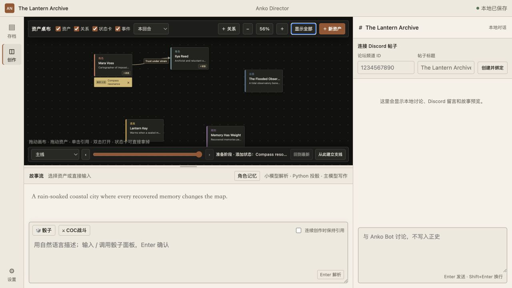
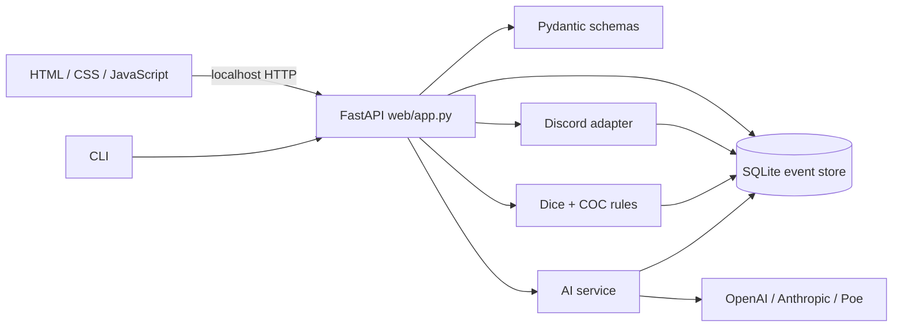

# Anko Director

[](https://github.com/chaoyian/anko-director/actions/workflows/ci.yml)
[](https://github.com/chaoyian/anko-director/releases)
[](https://www.python.org/)
[](LICENSE)

**A local-first AI director console for auditable Anko tabletop sessions.** You control the rules and narrative direction. AI converts natural-language instructions into structured proposals and story drafts; real randomness, rules adjudication, world state, and history remain under local Python and SQLite control.

[中文](README.md) · [Downloads](https://github.com/chaoyian/anko-director/releases) · [Architecture](docs/architecture.md) · [Changelog](CHANGELOG.md) · [Report an issue](https://github.com/chaoyian/anko-director/issues)

> **Development preview: `v0.7.0`.** Initial Windows, Linux, and macOS builds are unsigned and may trigger operating-system warnings. Download only from this repository's Releases page and verify the included SHA-256 checksum.



## Why this project exists

Many AI tabletop tools delegate randomness, rules, and narration to the model, making outcomes difficult to reproduce or audit. Anko Director separates those responsibilities:

- The **human director** controls rules, context, referenced assets, and final publication.
- The **parameter model** may only convert natural language into a strict `RollProposal`; it cannot invent dice results.
- The **local rules engine** executes rolls and COC 7e adjudication with a reproducible random stream.
- The **narrative model** writes a draft only after the outcome is fixed.
- The **SQLite event chain** stores world snapshots, branches, character memories, and hash evidence.
- The **Discord adapter** publishes approved content and imports audience messages without owning authoritative state.

## Feature status

### Core flow

- Natural-language parsing → readable confirmation → local roll → story draft → world-state and character-memory updates.
- `d100`, `NdM`, modifiers, multipliers, keep-highest/lowest, weighted tables, and draws without replacement.
- SHA-256 counter-based random stream; saved `seed_hex` values reproduce and verify outcomes across platforms.
- SQLite multi-campaign storage, monotonic event sequences, hash audit chains, world snapshots, and branching timelines.
- Explicit dice groups can bypass AI completely; sequential rolls can resolve together or reveal one at a time.

### World and rules

- Characters, scenes, items, rules, relationships, outcomes, and status cards share one infinite canvas.
- Character assets use stable IDs, traceable content snapshots, standard/custom stats, and subjective memories.
- COC 7e derived attributes and combat adjudication, including bonus/penalty dice, fighting back, armor, major wounds, dying, and first aid.
- Every completed turn creates a hash-verified world commit that can be reviewed, referenced, or branched.

### Integrations

- OpenAI Responses API, Anthropic Messages API, and Poe's OpenAI-compatible API.
- Separate parameter and narrative model configuration.
- Discord forum posts, reliable outbox, long-message splitting, and thread-specific audience-message ingestion.
- Credentials prefer the operating-system vault and never enter campaign saves or the repository.

## Quick start

### Download a preview build

Download the ZIP for your platform from [GitHub Releases](https://github.com/chaoyian/anko-director/releases):

| Platform | File |
|---|---|
| Windows x64 | `anko-director-windows-x64.zip` |
| Linux x64 | `anko-director-linux-x64.zip` |
| macOS Apple Silicon | `anko-director-macos-apple-silicon.zip` |
| macOS Intel | `anko-director-macos-intel.zip` |

Every ZIP has a matching `.sha256` file. On macOS/Linux:

```bash
shasum -a 256 -c anko-director-macos-apple-silicon.zip.sha256
```

On Windows PowerShell:

```powershell
Get-FileHash .\anko-director-windows-x64.zip -Algorithm SHA256
```

Extract and run `anko-director` (`anko-director.exe` on Windows). The service listens only on `127.0.0.1:8765` by default.

### Run from source

Python 3.12 is required. [uv](https://docs.astral.sh/uv/) is recommended:

```bash
git clone https://github.com/chaoyian/anko-director.git
cd anko-director
uv sync --extra dev --no-editable
uv run --no-editable anko-director serve
```

The browser opens `http://127.0.0.1:8765`. The dice engine is also available from the CLI:

```bash
uv run --no-editable anko-director roll d100
uv run --no-editable anko-director roll 2d20kh1
uv run --no-editable anko-director roll 3d6+2
```

Replay a result by passing its `seed_hex` back through `--seed`.

## Model and Discord configuration

Choose separate parameter and narrative models in Settings, then save the relevant credentials:

| Provider | Default interface | Environment variable |
|---|---|---|
| OpenAI | Responses API | `OPENAI_API_KEY` |
| Anthropic | Messages API | `ANTHROPIC_API_KEY` |
| Poe | OpenAI-compatible Chat Completions | `POE_API_KEY` |
| Discord | Bot API | `DISCORD_BOT_TOKEN` |

The Discord bot requires Message Content Intent and the minimum permissions needed to view channels, send messages, read history, and manage its own posts. Audience messages are reference material only: they cannot roll dice or mutate authoritative local state.

## Architecture



Key module dependencies:

| Module | Responsibility | Direct dependencies |
|---|---|---|
| `cli.py` | CLI, service startup, browser entry | config, dice, schemas, Uvicorn |
| `web/app.py` | Page and HTTP API orchestration | AI, COC, config, database, dice, Discord, schemas |
| `database.py` | SQLite schema, event chain, branches, world snapshots | character templates, stdlib SQLite |
| `dice.py` / `coc.py` | Reproducible randomness and local adjudication | schemas; COC depends on dice |
| `ai/service.py` | Proposals, stories, world deltas, memories | config, schemas, provider adapters |
| `discord_service.py` | Discord transport and reliable queue | discord.py, database |

See the [architecture guide](docs/architecture.md) for the directory map, dependency boundaries, migration rules, and extension points.

## Dependencies

Core runtime dependencies:

| Dependency | Purpose |
|---|---|
| FastAPI / Uvicorn / Jinja2 | Local web service, API, and server-rendered templates |
| Pydantic | Roll proposals, rule inputs, and API validation |
| SQLite (Python standard library) | Local saves, event chain, and world history |
| httpx | AI-provider HTTP client |
| discord.py | Discord bot and forum synchronization |
| keyring / platformdirs | OS credential vault and cross-platform data paths |
| PyInstaller | Portable builds that bundle Python |

All direct and transitive dependencies are locked by `uv.lock`. Development tooling includes Ruff, Pytest, pytest-asyncio, and Hypothesis.

## Local data and security model

- The default data directory is platform-specific and can be overridden with `ANKO_DATA_DIR`.
- Credentials prefer macOS Keychain, Windows Credential Locker, or Linux Secret Service.
- If the credential vault is unavailable, the UI keeps secrets in process memory only and reports that limitation.
- The service is designed for the loopback interface; **do not expose it directly to the public internet or an untrusted LAN**.
- `.env` files, databases, WAL files, logs, exported saves, build output, and credential files are ignored by Git.
- Follow [SECURITY.md](SECURITY.md) for vulnerability reports. Never paste real credentials or campaign saves into a public issue.

## Development and testing

```bash
uv sync --extra dev --no-editable
uv run --no-editable ruff check src tests scripts
uv run --no-editable pytest
uv run --no-editable python scripts/check_version.py
```

Release tags must match the project version. A pushed `v*` tag reruns tests on four platforms, packages the application, writes checksums, and creates a prerelease.

Read [CONTRIBUTING.md](CONTRIBUTING.md) before contributing.

## Roadmap

- Add Windows code signing and macOS signing/notarization.
- Decide on self-hosted Intel macOS builds or end-of-support before GitHub-hosted Intel runners retire in August 2027.
- Split the large web/database orchestration modules and stabilize internal service boundaries and migration tests.
- Add rule systems and AI providers without weakening local adjudication or provider isolation.
- Add save import/export, backups, and compatibility validation.

## License

Source code is available under the [PolyForm Noncommercial License 1.0.0](LICENSE), which permits personal entertainment, research, education, and noncommercial-organization use. Commercial use requires separate permission.

**This is not an OSI-approved open-source license.**
