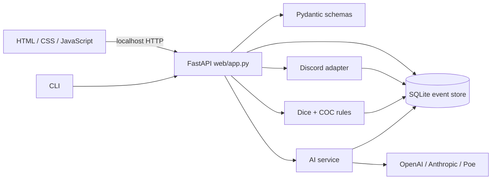

# Anko Director

[](https://github.com/chaoyian/anko-director/actions/workflows/ci.yml)
[](https://github.com/chaoyian/anko-director/releases)
[](https://www.python.org/)
[](LICENSE)

**本地优先、结果可审计的 AI 安科游戏导演台。** 你控制规则与叙事方向，AI 只负责把自然语言整理成结构化提案和故事草稿；真实随机、规则裁定、世界状态与历史版本均由本地 Python 和 SQLite 掌握。

[English](README.en.md) · [下载](https://github.com/chaoyian/anko-director/releases) · [架构](docs/architecture.md) · [变更记录](CHANGELOG.md) · [报告问题](https://github.com/chaoyian/anko-director/issues)

> **开发预览版：`v0.7.0`。** 首批 Windows、Linux 与 macOS 构建包未签名，操作系统可能显示安全提醒。请只从本仓库 Release 页面下载，并核对随包提供的 SHA-256。


## 为什么做这个项目

许多 AI 跑团工具把随机、规则和叙事全部交给模型，难以复现，也很难确认某次结果是否被改写。Anko Director 将职责拆开：

- **人类导演**决定规则、上下文、引用资产与最终发布内容。
- **传参模型**只把自然语言转换为严格的 `RollProposal`，不能编造骰点。
- **本地规则引擎**使用可复现随机流执行投骰和 COC 7 版裁定。
- **叙事模型**只在结果确定后创作草稿。
- **SQLite 事件链**保存世界快照、分支、人物记忆与哈希证据。
- **Discord 适配器**负责直播已确认内容并回收观众留言，不拥有本地状态写入权。

## 功能状态

### 核心流程

- 自然语言解析 → 可读确认 → 本地投骰 → 故事草稿 → 世界状态与人物记忆更新。
- 支持 `d100`、`NdM`、修正值、乘数、保留最高/最低骰、权重表和不放回抽取。
- SHA-256 计数器随机流；保存 `seed_hex` 后可跨平台复现并验证结果。
- SQLite 多游戏存档、连续事件编号、哈希审计链、世界快照和分支时间线。
- 显式骰组可完全绕过模型，连续骰可一次完成或逐次揭晓。

### 世界与规则

- 角色、场景、道具、规则、关系、事件结果与状态卡在同一无限画布管理。
- 角色资产具有稳定 ID、可追溯内容快照、标准/自定义属性和主观记忆。
- COC 7 版角色派生属性与战斗裁定，包括奖励/惩罚骰、反击、护甲、重伤、濒死与急救。
- 每个完成回合建立带校验哈希的世界提交，可只读回看、引用历史或从旧版本建立分支。

### 集成

- OpenAI Responses API、Anthropic Messages API 和 Poe OpenAI-compatible API。
- 传参模型与故事模型可独立配置。
- Discord 论坛帖子、可靠发送队列、长文拆分和指定帖子留言读入。
- 密钥优先存入操作系统凭据库，不写入游戏存档或仓库。

## 快速开始

### 下载预览版

从 [GitHub Releases](https://github.com/chaoyian/anko-director/releases) 下载对应平台的 ZIP：

| 平台 | 文件 |
|---|---|
| Windows x64 | `anko-director-windows-x64.zip` |
| Linux x64 | `anko-director-linux-x64.zip` |
| macOS Apple Silicon | `anko-director-macos-apple-silicon.zip` |
| macOS Intel | `anko-director-macos-intel.zip` |

每个 ZIP 都有同名 `.sha256` 文件。macOS/Linux 可执行：

```bash
shasum -a 256 -c anko-director-macos-apple-silicon.zip.sha256
```

Windows PowerShell 可执行：

```powershell
Get-FileHash .\anko-director-windows-x64.zip -Algorithm SHA256
```

解压后运行 `anko-director`（Windows 为 `anko-director.exe`）。程序默认只监听 `127.0.0.1:8765`。

### 从源码运行

要求 Python 3.12，推荐使用 [uv](https://docs.astral.sh/uv/)：

```bash
git clone https://github.com/chaoyian/anko-director.git
cd anko-director
uv sync --extra dev --no-editable
uv run --no-editable anko-director serve
```

浏览器会打开 `http://127.0.0.1:8765`。命令行也可直接验证骰子引擎：

```bash
uv run --no-editable anko-director roll d100
uv run --no-editable anko-director roll 2d20kh1
uv run --no-editable anko-director roll 3d6+2
```

输出中的 `seed_hex` 可通过 `--seed` 重放，得到相同结果。

## 模型与 Discord 配置

在设置页分别选择传参模型和故事模型，并保存相应凭据：

| 厂商 | 默认接口 | 环境变量 |
|---|---|---|
| OpenAI | Responses API | `OPENAI_API_KEY` |
| Anthropic | Messages API | `ANTHROPIC_API_KEY` |
| Poe | OpenAI-compatible Chat Completions | `POE_API_KEY` |
| Discord | Bot API | `DISCORD_BOT_TOKEN` |

Discord Bot 需要 Message Content Intent，以及查看频道、发送消息、读取历史和管理自身帖子所需的最小权限。观众留言只能作为导演素材，不能直接投骰或修改本地权威状态。

## 架构



关键模块依赖：

| 模块 | 职责 | 直接依赖 |
|---|---|---|
| `cli.py` | CLI、服务启动、浏览器入口 | config、dice、schemas、Uvicorn |
| `web/app.py` | 页面和 HTTP API 编排 | AI、COC、config、database、dice、Discord、schemas |
| `database.py` | SQLite schema、事件链、分支与世界快照 | character templates、标准库 SQLite |
| `dice.py` / `coc.py` | 可复现随机与本地规则裁定 | schemas；COC 依赖 dice |
| `ai/service.py` | 提案、叙事、世界变化和记忆工作流 | config、schemas、provider adapters |
| `discord_service.py` | Discord 收发与可靠队列 | discord.py、database |

完整目录、依赖边界、迁移约束和扩展点见 [架构文档](docs/architecture.md)。

## 依赖

运行时核心依赖及用途：

| 依赖 | 用途 |
|---|---|
| FastAPI / Uvicorn / Jinja2 | 本地 Web 服务、API 和服务端模板 |
| Pydantic | 投骰提案、规则输入和 API 数据校验 |
| SQLite（Python 标准库） | 本地存档、事件链和世界版本历史 |
| httpx | AI 厂商 HTTP 客户端 |
| discord.py | Discord Bot 与论坛帖子同步 |
| keyring / platformdirs | 系统凭据库和跨平台数据目录 |
| PyInstaller | 生成无需预装 Python 的便携构建包 |

全部直接与传递依赖由 `uv.lock` 锁定。开发工具包括 Ruff、Pytest、pytest-asyncio 和 Hypothesis。

## 本地数据与安全模型

- 默认数据目录由操作系统决定，可用 `ANKO_DATA_DIR` 覆盖。
- 密钥优先存放在 macOS Keychain、Windows Credential Locker 或 Linux Secret Service。
- 凭据库不可用时，网页只在当前进程内保留密钥并明确提示。
- 服务设计用于本机回环地址，**不要将它直接暴露到公网或不可信局域网**。
- `.env`、数据库、WAL、日志、导出存档、构建产物和凭据文件均被 Git 忽略。
- 安全问题请遵循 [安全策略](SECURITY.md)，不要在公开 Issue 中粘贴真实密钥或存档。

## 开发与测试

```bash
uv sync --extra dev --no-editable
uv run --no-editable ruff check src tests scripts
uv run --no-editable pytest
uv run --no-editable python scripts/check_version.py
```

发布标签必须与项目版本一致。推送 `v*` 标签后，GitHub Actions 会在四个平台上重新运行测试、打包、生成校验值并创建预发布版本。

贡献前请阅读 [CONTRIBUTING.md](CONTRIBUTING.md)。

## 路线图

- 为 Windows 构建增加代码签名，为 macOS 增加签名与公证。
- 在 2027 年 8 月 GitHub 托管 Intel runner 支持结束前，决定 Intel macOS 的自托管或停止支持策略。
- 拆分当前较大的 Web/数据库编排模块，稳定内部服务边界与迁移测试。
- 增加更多规则系统和 AI Provider，同时保持本地规则裁定与 provider 隔离。
- 增加存档导入/导出、备份和兼容性验证。

## 许可证

源代码按 [PolyForm Noncommercial License 1.0.0](LICENSE) 提供，允许个人娱乐、研究、教育和非商业组织用途。商业使用需要另行授权。

**该许可证不是 OSI 定义的开源许可证。**
