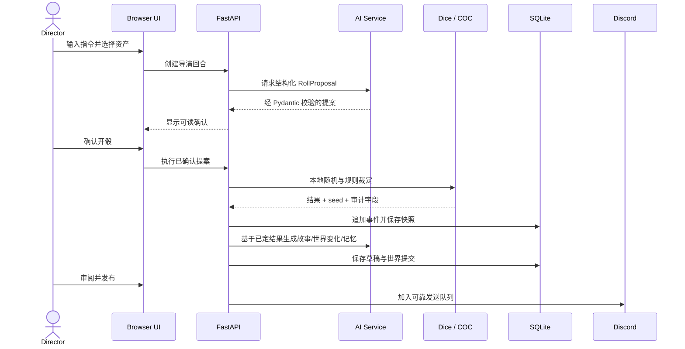

# Anko Director 架构 / Architecture

[中文](#中文) · [English](#english)

## 中文

### 设计原则

1. **本地权威**：随机数、规则裁定、事件记录和世界状态都在本地完成。
2. **模型最小权限**：模型提出结构化参数或草稿，不能直接写入骰点和已确认状态。
3. **结果可追溯**：随机种子、事件哈希、资产快照和世界提交共同形成证据链。
4. **适配器隔离**：AI 厂商和 Discord 是边缘集成，核心规则不依赖具体服务。

### 运行时数据流

### 目录与依赖边界

| 路径 | 所有权与边界 |
|---|---|
| `src/anko_director/cli.py` | 进程入口；不实现业务状态。 |
| `src/anko_director/web/` | HTTP、模板和浏览器交互的编排层；不自行生成随机结果。 |
| `src/anko_director/schemas.py` | 跨层输入输出契约；规则和 HTTP 共享。 |
| `src/anko_director/dice.py` | 通用骰子语法、确定性随机流和结果复核。 |
| `src/anko_director/coc.py` | COC 7 版纯规则函数，依赖骰子层，不依赖 Web/AI。 |
| `src/anko_director/database.py` | SQLite schema、迁移、事件链、快照和查询。 |
| `src/anko_director/ai/` | AI 工作流与厂商适配器；结构化结果必须回到 schemas 校验。 |
| `src/anko_director/discord_service.py` | Discord 边缘适配器；通过 database/outbox 实现可靠投递。 |

允许的核心依赖方向：`web → services/rules/database`、`AI service → providers`、`COC → dice`、`dice → schemas`、`Discord → database`。核心规则不得反向导入 Web、Discord 或具体 AI 厂商。

### SQLite 与迁移

- `Database.initialize()` 负责首次建表和顺序迁移，迁移版本记录在 `schema_migrations`。
- 迁移必须可重复执行，并兼容已有 `0.5.x–0.7.x` 数据。
- 已发布事件和世界提交视为追加式审计数据；修订通过新事件、提交或分支表达。
- schema 变更必须增加数据库测试，覆盖新库、旧版本升级和事件链复核。

### 扩展点

- **AI Provider**：实现 `AIProvider.text()` 和 `AIProvider.structured()`，在 service 层注册；认证与 HTTP 细节留在 adapter 内。
- **规则系统**：新增独立纯函数模块和 Pydantic 输入模型；随机数只能来自 `DeterministicRandom`。
- **发布目标**：复用 outbox/状态机语义，不让外部平台回调直接改写世界状态。
- **Web 功能**：新增 endpoint 时先定义 schema，再调用数据库或服务层；模板和 JavaScript 不直接访问本地文件。

## English

### Design principles

1. **Local authority:** randomness, adjudication, events, and world state are produced locally.
2. **Least-privileged models:** models propose structured parameters or drafts; they cannot commit dice results or confirmed state.
3. **Traceable outcomes:** seeds, event hashes, asset snapshots, and world commits form an evidence chain.
4. **Adapter isolation:** AI vendors and Discord remain edge integrations; core rules do not depend on a specific service.

### Runtime data flow

The sequence diagram above is language-neutral: a director confirms a validated proposal before local rules execute it. Only then can narrative and world-analysis requests run, and only reviewed content enters the Discord outbox.

### Directory and dependency boundaries

| Path | Ownership and boundary |
|---|---|
| `src/anko_director/cli.py` | Process entry point; owns no business state. |
| `src/anko_director/web/` | HTTP, templates, and browser orchestration; never invents randomness. |
| `src/anko_director/schemas.py` | Cross-layer input/output contracts shared by rules and HTTP. |
| `src/anko_director/dice.py` | Dice notation, deterministic random stream, and result verification. |
| `src/anko_director/coc.py` | Pure COC 7e rules; depends on dice, never Web or AI. |
| `src/anko_director/database.py` | SQLite schema, migrations, event chain, snapshots, and queries. |
| `src/anko_director/ai/` | AI workflows and provider adapters; structured output returns to schema validation. |
| `src/anko_director/discord_service.py` | Edge adapter using the database/outbox for reliable delivery. |

Allowed core dependency directions are `web → services/rules/database`, `AI service → providers`, `COC → dice`, `dice → schemas`, and `Discord → database`. Core rules must not import Web, Discord, or a concrete AI provider.

### SQLite and migrations

- `Database.initialize()` creates a fresh schema and applies ordered migrations tracked by `schema_migrations`.
- Migrations must be repeatable and retain compatibility with existing `0.5.x–0.7.x` data.
- Published events and world commits are append-oriented audit data; revisions use new events, commits, or branches.
- Schema changes require database tests for fresh databases, upgrades, and event-chain verification.

### Extension points

- **AI provider:** implement `AIProvider.text()` and `AIProvider.structured()`, then register it in the service layer; keep authentication and HTTP details inside the adapter.
- **Rule system:** add a pure-function module and Pydantic inputs; consume randomness only through `DeterministicRandom`.
- **Publishing target:** reuse outbox/state-machine semantics and never let external callbacks mutate world state directly.
- **Web feature:** define schemas before endpoints, call the database or service layer, and keep templates/JavaScript away from direct local-file access.
